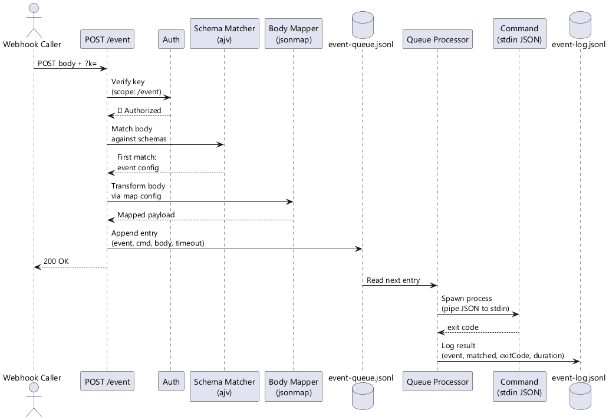

# Event Gateway

Jeeves Server includes a webhook gateway that receives HTTP POST requests, validates them against JSON Schema rules, and dispatches matched events to shell commands via a durable queue.

## Overview



## Configuration

Events are defined in your config file:

```json
{
  "events": {
    "notion-page-update": {
      "schema": {
        "type": "object",
        "properties": {
          "type": { "const": "page.content_updated" }
        },
        "required": ["type"]
      },
      "cmd": "node /path/to/handler.js",
      "map": {
        "pageId": {
          "$": {
            "method": "$.lib._.get",
            "params": ["$.input", "data.page_id"]
          }
        },
        "type": {
          "$": { "method": "$.lib._.get", "params": ["$.input", "type"] }
        }
      },
      "timeoutMs": 60000
    }
  }
}
```

### Schema matching

Each event has a [JSON Schema](https://json-schema.org/) that's validated against the incoming request body using [ajv](https://ajv.js.org/). The **first matching** event wins — order matters if schemas could overlap.

Common patterns:

```json
// Match a specific event type
{ "type": "object", "properties": { "type": { "const": "page.content_updated" } }, "required": ["type"] }

// Match any object with an "action" field
{ "type": "object", "required": ["action"] }

// Match based on nested field
{ "type": "object", "properties": { "data": { "type": "object", "properties": { "status": { "const": "completed" } } } } }
```

### Body mapping with JsonMap

When an event config includes a `map` object, the incoming body is transformed via [@karmaniverous/jsonmap](https://github.com/karmaniverous/jsonmap) before being passed to the command. This extracts only the fields you need from potentially large webhook payloads.

The `lib` object available in mappings includes [`radash`](https://github.com/sodiray/radash) as `_`.

When `map` is omitted, the full webhook body is passed as-is.

**Example — Notion sends a large payload, we extract just two fields:**

```json
{
  "pageId": {
    "$": { "method": "$.lib._.get", "params": ["$.input", "data.page_id"] }
  },
  "type": {
    "$": { "method": "$.lib._.get", "params": ["$.input", "type"] }
  }
}
```

Input: `{ type: "page.content_updated", data: { page_id: "abc123", ... } }` Output to command: `{ pageId: "abc123", type: "page.content_updated" }`

## Authentication

Webhook callers must authenticate with a key that has scope access to `/event`:

```json
{
  "keys": {
    "webhook-notion": {
      "key": "random-seed-string",
      "scopes": ["/event"]
    }
  }
}
```

Your config contains a **seed** — a secret string that never leaves the server. The actual URL key is **derived** from the seed by the server. To get it:

```bash
curl -s "https://your-domain.com/insider-key" -H "X-API-Key: <your-seed>"
# Returns: { "key": "a1b2c3d4..." }
```

Use the returned key in webhook URLs:

```bash
curl -X POST "https://your-domain.com/event?k=<derived-key>" \
  -H "Content-Type: application/json" \
  -d '{"type": "page.content_updated", "data": {"page_id": "abc123"}}'
```

Insiders with `/event` scope can also copy an authenticated event URL directly from the **Event link button** in the header bar — no command line needed.

See the [Insiders, Outsiders & Sharing](sharing.md) guide for full details on the key model.

## Queue Processing

Events are processed through a **durable JSONL queue**:

1. **Append** — Matched events are appended to the queue file with metadata, one `\n`-terminated line each, under an in-process queue lock
2. **Drain** — A self-scheduling drain loop reads one batch at a time (no overlapping batches): at most 1 MiB from the cursor, complete lines only; the queue is never read whole
3. **Execute** — Each entry's `cmd` runs through the shell with the (optionally mapped) body piped as JSON to stdin, in a pool of `eventQueueConcurrency`: the next entry starts as soon as any running one finishes
4. **Timeout** — Commands are ended, with their process tree, after `timeoutMs` (per-event or the global `eventTimeoutMs` default; see [Timeouts](#timeouts))
5. **Errors logged** — The command is responsible for its own error handling; the queue processor logs and moves on
6. **Cursor** — Once every entry of the batch has finished, the cursor file (see [Cursor](#cursor)) moves past the batch, surviving restarts

The drain loop sleeps 5 seconds when there is nothing to do and continues at once after a batch.

### Queue configuration

| Key | Type | Default | Description |
| --- | --- | --- | --- |
| `eventQueue` | `string` | `{installDir}/logs/event-queue.jsonl` | Absolute path to the durable queue JSONL file. Cursor file is derived as `eventQueue + '.cursor'`. Set this to a stable location outside `node_modules`. |
| `eventQueueConcurrency` | `number` | `3` | Maximum number of queue entries processed concurrently within a single batch. |

### Queue entry format

```jsonl
{
  "ts": "2026-02-15T05:00:00Z",
  "event": "notion-page-update",
  "cmd": "node handler.js",
  "body": {
    "pageId": "abc123"
  },
  "timeoutMs": 60000
}
```

### Delivery: at least once

The queue survives server restarts. On startup, the processor reads the cursor file and resumes from where it left off. The cursor moves once per batch, after every entry in it has finished (success, failure or timeout), so a crash or restart mid-batch runs that batch again: an entry can run more than once. Make event commands idempotent.

### Cursor

The cursor file is the queue path plus `.cursor` (`logs/event-queue.cursor` when `eventQueue` isn't set). It is JSON, replaced atomically (temp file, then rename):

```json
{ "v": 1, "offset": 2048, "size": 4096, "head": "<sha256 hex>", "headLen": 64 }
```

| Field | Meaning |
| --- | --- |
| `offset` | Byte offset just past the last processed line |
| `size` | Queue size when the cursor was written |
| `head`, `headLen` | sha256 of the queue's first `headLen` bytes (`min(64, size)`); a queue that has only grown still matches |

A cursor from an earlier version (a plain byte offset) is still read. On each pass the processor checks the cursor against the queue:

| Cursor | Processing resumes at | Recorded |
| --- | --- | --- |
| Missing (new install) | the start of the queue | — |
| Unreadable, empty or not a cursor | the **end** of the queue: nothing already in it is replayed | error log; `queue_cursor_reset` in `webhook-events.jsonl`; `health.eventQueue.lastCursorReset` |
| Past the end of the queue (truncated), or the queue's first bytes changed (replaced) | the start of the current queue: nothing in it is lost | warning; `queue_rewound`; `health.eventQueue.lastRewind` |

### Damaged lines

A write cut short (a full disk, a crash) leaves a line without its `\n`. Before the first append after start-up, each JSONL writer (the queue, `webhook-events.jsonl`) checks the file's last byte and ends a torn line first, so the fragment stays on its own line. The processor leaves an unterminated last line for a later pass. A line that isn't a valid queue entry is skipped: a warning with its byte offset, a `queue_parse_error` entry (offset and a 200-character preview) in `webhook-events.jsonl`, and a count in `health.eventQueue.parseErrors`. Later entries run as usual. Readers of the event log (`GET /api/events` and each event log write) skip malformed lines the same way.

### Rotation

When the processor has caught up and the queue is larger than 64 MiB, it renames the queue to `<queue>.1` (replacing any previous `.1`) under the queue lock and resets the cursor; the next append starts a fresh queue. If the rename fails (Windows may refuse while another process has the file open), rotation is tried again on a later idle pass. Only one `.1` generation is kept: processed entries aren't needed for delivery, and the event log keeps the history.

### Timeouts

When an entry's timeout fires:

- **Linux and macOS:** the command runs in its own process group. The group gets `SIGTERM`, then `SIGKILL` 5 seconds later.
- **Windows:** `taskkill /PID <pid> /T` ends the process tree, then `taskkill /PID <pid> /T /F` 5 seconds later.

The event log entry records `timedOut: true` and the exit code (`null` when the command was killed by a signal). The entry's pool slot frees when the command exits or, at the latest, 5 seconds after the forced kill.

### Status

`GET /status` reports the queue's progress in `health.eventQueue` (counts since the server started; timestamps ISO):

| Field | Meaning |
| --- | --- |
| `offset` | Byte offset the processor has reached |
| `size` | Queue size in bytes |
| `pendingBytes` | `size - offset` |
| `parseErrors` | Queue lines skipped as malformed |
| `lastCursorReset` | Last time an untrustworthy cursor was reset (optional) |
| `lastRewind` | Last time a truncated or replaced queue was processed from its start (optional) |

## Event Logging

All events — matched and unmatched — are logged to the event log file (co-located with the queue when `eventQueue` is configured, otherwise `{installDir}/logs/event-log.jsonl`):

```jsonl
{"ts":"2026-02-15T05:00:00Z","event":"notion-page-update","matched":true,"exitCode":0,"durationMs":1234}
{"ts":"2026-02-15T05:00:01Z","event":null,"matched":false,"bodyPreview":"..."}
```

### Log purging

Each log write also purges entries older than `eventLogPurgeMs` (default: 30 days). This keeps the log file from growing unbounded. The purged log replaces the file atomically (temp file, then rename), so a failed write leaves the previous log intact.

## Writing Event Handlers

Your command receives the (optionally mapped) body as JSON on **stdin**:

```javascript
// handler.js
const chunks = [];
process.stdin.on('data', (chunk) => chunks.push(chunk));
process.stdin.on('end', () => {
  const body = JSON.parse(Buffer.concat(chunks).toString());
  console.log('Received:', body.pageId);
  // Do your work here
});
```

**Key points:**

- The command runs in the server's working directory
- stdout/stderr are captured for logging
- Exit code 0 = success, anything else = failure (logged but not retried)
- The command must complete within `timeoutMs` or it's killed

## Global Settings

```json
{
  "eventTimeoutMs": 30000,
  "eventLogPurgeMs": 2592000000
}
```

## Monitoring

### Via API

```bash
# Get the 20 most recent event log entries (insiders with no scopes configured)
curl "http://localhost:1934/api/events?limit=20&k=<machine key>"
```

`GET /api/events?limit=N` (1–100, default 20) returns an array of entries, newest first, each with `ts`, `event`, `matched`, `exitCode` and `durationMs` (and `timedOut: true` when the command timed out). Unmatched entries also carry the stored body (`bodyPreview`, with `truncated` and `originalBytes` when it was cut at 256 KiB). It is only for insiders with no scopes configured: a machine key or insider session without `scopes`. Any configured scopes refuse access, even `allow: ['/**']`: such insider sessions get 403, and such machine keys are refused. `/status` does not return event log entries.

### Via log files

Check the event log for failures (adjust the path if `eventQueue` is configured):

```bash
# Recent failures
grep '"exitCode":' /path/to/event-log.jsonl | grep -v '"exitCode":0'

# Unmatched events (potential misconfiguration)
grep '"matched":false' /path/to/event-log.jsonl
```

## Example: Notion Webhook Integration

1. **Configure the event** in `your config file` (see Configuration above)
2. **Create a scoped key** for the webhook
3. **Register the webhook URL** in Notion:
   - Settings → Connections → Add a connection
   - Webhook URL: `https://your-domain.com/event?k=<webhook-derived-key>`
4. **Write your handler** to process the mapped body
5. **Verify** by triggering a page update and checking `logs/event-log.jsonl`

> **Note:** Notion signs webhooks with HMAC. For production use, add signature verification in your handler before processing.
